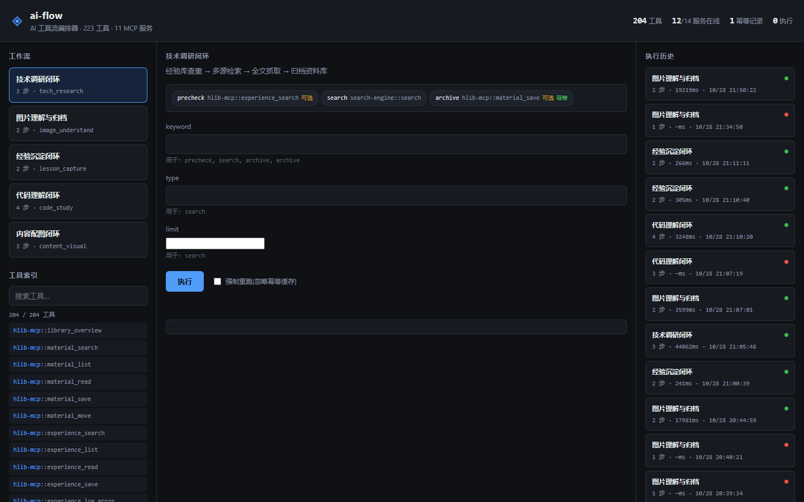

# ai-flow — AI 工具流编排器

> 把散落在 12 个 MCP 服务里的 223 个工具，收敛成「说出一个意图 → 编排器负责选工具、传参数、处理失败、落结果」的统一入口。

## 1. 为什么做这个

本机已注册 12 个 MCP 服务，暴露 223 个工具（Photoshop 119、novel-library 34、xiangsu 28、hlib 11、cv-annot 10、search-engine 9、experience 4……）。

问题不在于工具不够，而在于**每次干活都要人肉重做同一套编排**。以"做一次技术调研"为例，真实路径是：

```
经验库查重 → 多源检索 → 全文抓取 → 视觉模型读图 → 归档资料库 → 沉淀经验
```

六步，每一步的工具选择、参数拼装、失败重试、结果落库，全部靠人肉记忆和手工执行。工具越多，这个成本越高，而且无法复用、无法审计、无法回归。

**ai-flow 做的事**：把这套编排固化成可声明、可执行、可观测的工作流，并对外暴露为 MCP 工具，让 AI 自己就能调用。

## 2. 架构

```
                        ┌──────────────────────────────────┐
   AI / CLI / 脚本 ────▶ │        ai-flow MCP Server        │
                        │  flow_list / flow_run /          │
                        │  flow_run_custom / flow_tools   │
                        └───────────────┬──────────────────┘
                                        │
                        ┌───────────────▼──────────────────┐
                        │         WorkflowEngine           │
                        │  变量渲染 ${step.field}          │
                        │  超时 · 重试退避 · 熔断 · optional │
                        │  可观测:每步入参/出参/耗时/状态   │
                        └───────────────┬──────────────────┘
                                        │
                        ┌───────────────▼──────────────────┐
                        │         ToolRegistry             │
                        │  自动发现 12 个 MCP 服务的 223 工具│
                        │  统一命名 服务名::工具名          │
                        │  保留 JSON Schema 供选型         │
                        └───────────────┬──────────────────┘
                                        │
   ┌────────────┬────────────┬─────────┴────┬────────────┬────────────┐
   ▼            ▼            ▼              ▼            ▼            ▼
search-engine hlib-mcp   cv-annot    novel-library  experience   photoshop
 ima       image-mcp     vision-mcp     xiangsu       mesh-mcp
```

| 关键设计 | 实现 |
|---|---|
| 注册表不硬编码任何工具清单 | 全部从运行中的 MCP 服务实际探测得到。新注册一个 MCP 服务,它自动进入索引与可编排范围 |
| **参数适配层** | 不同服务对同一语义参数要求不一致(如 vision-mcp 要 base64 data URI,调用方给的是文件路径)。适配逻辑集中在 `core/wrappers.js`,不散落在各工作流 |
| **运行环境适配层** | 自动读 Windows 注册表拿系统代理并注入到需要访问境外站的服务(`core/env_adapt.js`),修复下游服务的网络缺陷 |

## 2.1 编排层替下游服务解决的两个真实问题

这两处都是实测中暴露、由编排层统一修复的:

**问题一:Node fetch 不走系统代理**
`vision-mcp` 访问境外网关报 `fetch failed`。根因是本机系统代理(`127.0.0.1:12002`)已在注册表启用,但 Windows 只让浏览器读它,Node 原生 fetch 不读——表现像"服务挂了",实际是没走代理。
修复:编排层读注册表取真实代理地址,注入 `HTTP_PROXY`/`HTTPS_PROXY`,并显式开启 `NODE_USE_ENV_PROXY=1`(Node 原生 fetch 默认不认代理环境变量)。

**问题二:参数契约不一致**
`vision-mcp.vision_describe_image` 要求 `image` 是 base64 data URI,而调用方手里是文件路径。
修复:在调用前统一做参数适配,文件路径自动转 data URI。

**问题三:模型标识失配(配置层)**
网关上模型名是 `google/gemma-4-31b-it`,而 vision-mcp 配置写的是 `selfdeploy/gemma-4-31b-it`,返回 `model_not_found`。且 31B 视觉模型单次推理超过 250 秒。
修复:改为 `meta/llama-3.2-11b-vision-instruct`,实测 17.8 秒返回正确结果。

> 这三点合起来说明编排层的价值不止于"串步骤"——**它也是下游服务的统一适配层**。

## 3. 核心工程点

| 能力 | 实现 | 为什么重要 |
|---|---|---|
| 协议实现 | 零依赖 JSON-RPC 2.0 over stdio（client 与 server 各一份，共 ~400 行） | 不引 SDK，项目可移植；也说明真的理解协议而非调库 |
| 统一索引 | `服务名::工具名`，惰性连接、自动发现 | 加服务即加能力，无需改代码 |
| 变量传递 | `${step.field}` 模板递归渲染（支持字段级引用） | 步骤间数据流是编排的核心；字段级引用让大输出只搬需要的部分 |
| 失败语义 | 区分可重试（网络/超时）与不可重试（参数错/工具不存在） | 盲目重试会放大故障 |
| 重试退避 | 指数退避 `backoff_ms × attempt` | 避免瞬时故障打爆下游 |
| 熔断 | 同服务连续失败 3 次短路，30s 后半开恢复 | 一个服务挂了不该拖垮整条链 |
| optional 步骤 | 失败不中断主链 | 归档类步骤不该让主任务失败 |
| **幂等层** | 副作用步骤声明业务键（`idempotency_key`），账本持久化；命中即复用结果跳过调用，`--force` 可绕过 | 重跑失败链不再重复归档/重复写库——跨步骤副作用安全 |
| **进程健康管理** | 请求超时或进程退出时标记不健康、终止进程，下次调用自动重建干净实例 | 不留僵死进程；下游崩溃后自愈，无需重启编排器 |
| 可观测 | 每步记录渲染后实参/出参/字节数/耗时/状态，全链路落盘 | 「上次跑得怎么样」「参数到底传了什么」可回答 |

## 3.1 Web 看板

`node server.js` 后打开 `http://127.0.0.1:8792`：

- 左栏：5 个内置工作流 + 204 个工具的统一索引（实时搜索）
- 中栏：步骤预览（标注"可选/幂等"）→ 参数表单（从模板自动推断）→ 执行
- 右栏：执行历史（每步状态/耗时/幂等命中）
- SSE 实时推送：执行过程中每步开始/结束/重试即时上屏



启动时自动预热全部 MCP 服务（实测 12/14 在线、204 工具入索引，约 3 秒）。

## 4. 内置工作流

| ID | 名称 | 串联 | 对应痛点 |
|---|---|---|---|
| `tech_research` | 技术调研闭环 | 经验库查重 → 多源检索 → 归档资料库 | 信息处理与整理 |
| `image_understand` | 图片理解与归档 | 视觉模型读图 → 结论存资料库 | 信息处理与整理 |
| `lesson_capture` | 经验沉淀闭环 | 开工前读防错清单 → 踩坑写入收件箱 | 写代码与开发效率 |
| `code_study` | 代码理解闭环 | 导入代码库 → 读文件 → 写标注 → 查覆盖 | 写代码与开发效率 |
| `content_visual` | 内容配图闭环 | 搜参考图 → 生成配图 → 归档提示词 | 内容创作生产 |

`flow_run_custom` 支持临时组合任意工具链，不必预定义工作流。

## 5. 用法

### 命令行
```bash
node scripts/flow.js list                          # 列出工作流
node scripts/flow.js tools 搜索                      # 查工具
node scripts/flow.js run tech_research --keyword "AI Agent 工具编排 2026" --type article --limit 10
node scripts/flow.js runs                          # 历史执行
node scripts/scan_tools.js                         # 重建工具索引快照
node tests/e2e.js                                  # 自测(22 项断言)
```

### 作为 MCP 服务（推荐）
```bash
node scripts/register-mcp.js      # 注册进 ZCode,重启会话生效
```
注册后 AI 可直接调用 `flow_list` / `flow_run` / `flow_run_custom` / `flow_tools` / `flow_capabilities` / `flow_history`。

### 自定义工作流
```json
{
  "id": "my_chain",
  "name": "自定义链",
  "params": { "topic": "MCP" },
  "steps": [
    { "id": "s1", "tool": "search-engine::search", "args": { "keyword": "${topic}" } },
    { "id": "s2", "tool": "hlib-mcp::material_save", "args": { "name": "${topic}", "content": "${s1}" }, "optional": true }
  ]
}
```

## 6. 实测结果

| 项目 | 结果 |
|---|---|
| MCP 服务探测 | 12 个注册服务，11 个可用（slider-mcp 退出码 1） |
| 工具发现 | **223 个工具**建成统一索引（Photoshop 119 / novel-library 34 / xiangsu 28 / hlib 11 / cv-annot 10 / search-engine 9 / 其他 12） |
| 动态发现验证 | 像塑编辑器未启动时 xiangsu 连接失败，索引自动降为 **203** 个工具，服务恢复后自动回到 223——索引与实际在线服务严格一致，无硬编码 |
| 自测断言 | **34/34 通过**（协议握手、变量传递、重试计数、optional 语义、幂等命中/绕过/持久化、进程超时终止、注册表统计），且在**无 ZCode 配置的干净环境**（模拟 CI）同样全过 |
| 真实工作流 | `tech_research` 端到端跑通，中文关键词检索返回真实结果，自动归档进资料库 |
| 真实工作流 | `lesson_capture` 跑通（约 290ms），经验真实写入经验库收件箱 |
| 真实工作流 | `code_study` 跑通（约 1.9s），导入代码库→重扫→读文件→查覆盖统计全绿 |
| 真实工作流 | `image_understand` 跑通（约 18s），视觉模型正确读出图像内容并归档 |
| 幂等实测 | 同关键词重跑技术调研：archive 步骤 **1ms 幂等命中**，未产生重复归档；`--force` 绕过缓存重新执行 |
| 失败路径 | 下游服务未启动时如实报错并重试 3 次；optional 步骤失败不中断主链 |
| 依赖 | 零 npm 依赖，Node 18+ |

### 编排开销基准

用本地 mock MCP 服务（零网络延迟）隔离测量编排引擎自身开销，与「手工逐次 await 调用」对比，重复 30 次取平均：

| 步骤数 | 手工路径 | 工作流路径 | 引擎额外开销 |
|---|---|---|---|
| 1 步 | 0.19ms | 0.21ms | +10.4%（+0.02ms） |
| 5 步 | 0.89ms | 0.89ms | +0.4%（+0.00ms） |
| 20 步 | 1703.48ms | 1771.82ms | +4.0%（+68ms） |

**结论**：引擎的编排开销约为每步 0.01–0.4ms，相对下游工具动辄数秒的真实耗时可以忽略不计。编排层是"免费"的。

### 业务价值基准:「人工中转成本」

这是比耗时更有说服力的指标。AI 直接调工具时，工具输出必须**整段进入模型上下文**，再由模型挑选、拼装、传给下一步——输出越大，token 越贵、越容易撑爆上下文。编排器的字段级引用（`${step.field}`）让大输出留在编排器内部，只传需要的字段。

对比设计：**只做一次检索，两条路径共享同一份输出**（否则两次检索结果本身不同，无从对比）：

| 路径 | 中转字节数 | 折合 token | 归档内容 |
|---|---|---|---|
| 人工路径（输出整段过上下文） | **40.6 KB** | ~10,791 | 20.0 KB |
| 编排路径（字段级引用） | **19.9 KB** | ~5,295 | 20.0 KB |
| **减少** | **50.9%** | **~51%** | **逐字节一致** |

中转明细说清了省在哪：search 完整输出 23.3KB（含 stats/platforms/warnings 等元数据），字段级引用 `${search.results}` 只搬 19.9KB 的结果数组。

**诚实说明**：
- 这是「中转成本」的量化，不是「省了多少分钟」的工时测量——工时受人的熟练度影响，难以客观测量；中转成本是系统固有属性，可测量、可复现。
- 耗时对比（人工 67s vs 编排 42s）没有意义：两条路径调同一批工具，差异全是下游网络波动，不归功于编排层。

## 7. 目录

```
core/mcp_client.js    MCP stdio 客户端（零依赖 JSON-RPC + 进程健康管理）
core/registry.js      工具注册表（自动发现 + 惰性连接 + 代理/参数适配）
core/engine.js        编排引擎（重试/熔断/幂等/变量渲染/审计）
core/idempotency.js   幂等账本（业务键去重,持久化）
core/wrappers.js      参数适配层（文件路径→data URI 等）
core/env_adapt.js     环境适配层（读注册表注入系统代理）
workflows/index.js    内置工作流定义
mcp/server.js         MCP 服务端（把编排能力暴露给 AI）
server.js             Web 看板服务（REST + SSE）
web/                  看板前端（零依赖原生 JS）
scripts/flow.js       CLI
scripts/scan_tools.js 工具索引扫描
scripts/register-mcp.js 注册到 ZCode
benchmark/            三个基准:编排开销 / 端到端 / 中转成本
tests/e2e.js          端到端自测(34 项断言,CI 可跑)
tests/mock_mcp_server.js mock 服务(隔离外网验证引擎逻辑)
.github/workflows/ci.yml  CI(Ubuntu + Windows 双平台)
```

## 8. 已知边界

- 依赖各下游 MCP 服务自身可用性；本编排器做进程级自愈（超时/退出后重建），但不做服务内部逻辑的容错。
- 变量渲染只支持 `${step.field}` 点路径，不支持表达式求值（刻意保持简单，避免注入风险）。
- 幂等账本按"键命中即跳过"工作，不检测下游状态变化——同键但下游数据已变时需 `--force`。
- 工作流目前是静态声明式，未做动态编排（LLM 自主规划）。这是下一步的方向。
- 仅在 Windows 实测；CI 覆盖 Ubuntu 但真实 MCP 服务生态（路径分隔符、进程信号）未在 Linux 上验证。

## 9. 合规

- Ultralytics 无关；本项目不涉及训练框架授权。
- 下游 MCP 服务各自的 API 密钥与授权由各自服务方负责，本项目不存储任何密钥。
